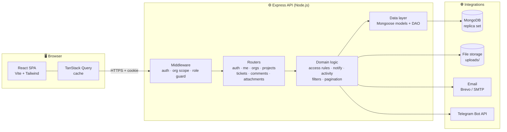
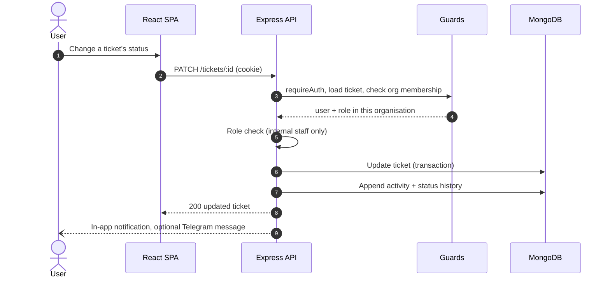
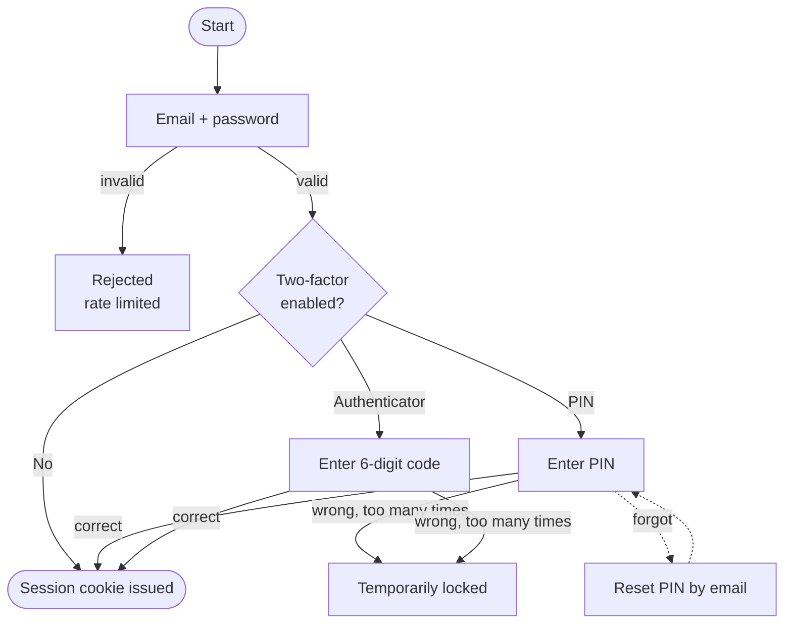
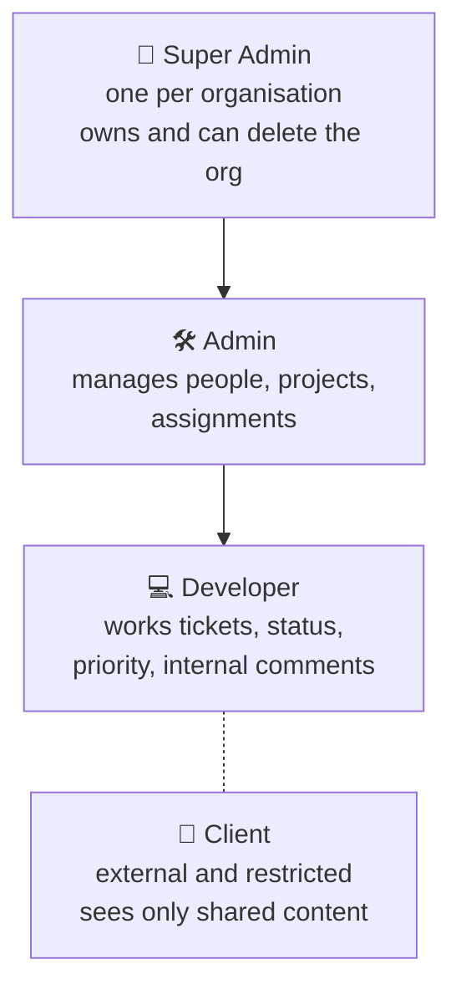
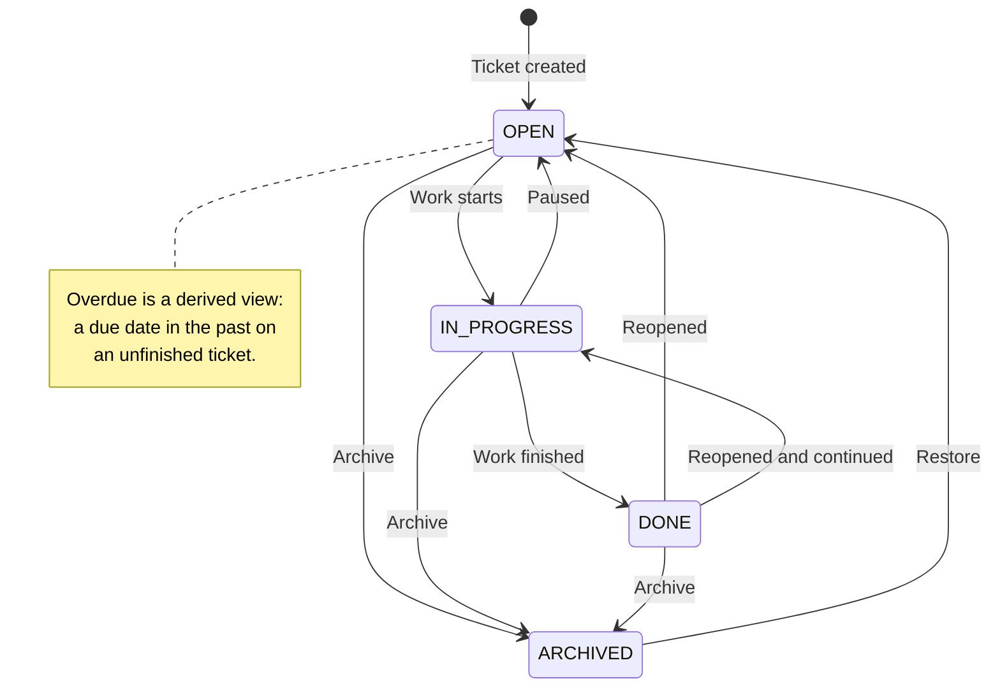
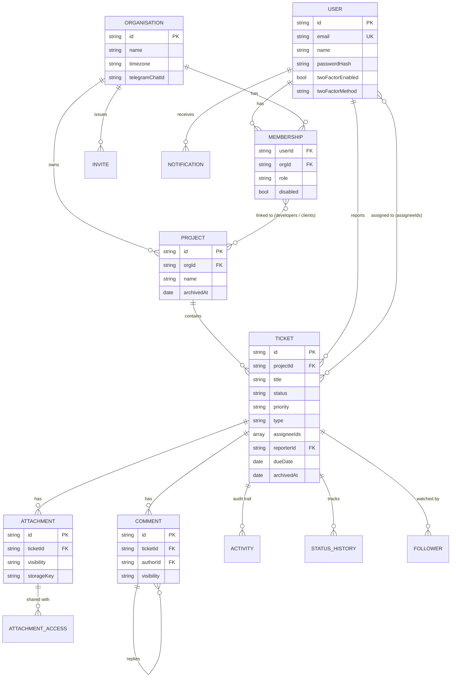

<div align="center">

# 🎫 Ticket Management

**A multi-tenant ticket and project platform with role-based access, client-safe collaboration, and two-factor security.**


</div>

---

## 📑 Table of Contents

- [Overview](#-overview)
- [Features](#-features)
- [Tech Stack](#-tech-stack)
- [Architecture](#-architecture)
- [Roles and Permissions](#-roles-and-permissions)
- [Ticket Lifecycle](#-ticket-lifecycle)
- [Data Model](#-data-model)
- [Project Structure](#-project-structure)
- [Getting Started](#-getting-started)
- [Environment Variables](#-environment-variables)
- [API Overview](#-api-overview)
- [Notifications](#-notifications)
- [Scripts](#-scripts)
- [Deploying Your Own Instance](#-deploying-your-own-instance)
- [Security Notes](#-security-notes)

---

## 🔭 Overview

Ticket Management lets a company run several **organisations (workspaces)**, each with its own
people, projects and tickets. Internal staff (Super Admin, Admin, Developer) work tickets, while
**Clients** get a restricted view: they can raise tickets and follow only the discussion and files
that were explicitly shared with them.

Everything is scoped to an organisation, so data from one workspace is never visible in another.

---

## ✨ Features

| Area | What you get |
|---|---|
| 🏢 **Workspaces** | Multiple isolated organisations, per-organisation timezone, one Super Admin each |
| 📁 **Projects** | Create, archive and restore projects; assign developers and clients per project |
| 🎟️ **Tickets** | Type (Bug / Feature / Task), priority, due date, estimate, **multiple assignees**, followers |
| 🔁 **Workflow** | Open → In Progress → Done, bulk status updates, duplicate, move, archive, restore |
| 💬 **Collaboration** | Threaded comments, `@mentions`, **Internal vs Client-visible** visibility, Markdown editor |
| 📎 **Attachments** | Drag-and-drop uploads with per-file visibility (Internal, Client-visible, or selected people) |
| 🧾 **Audit trail** | Append-only activity timeline for every ticket change |
| 🔎 **Smart lists** | Dashboard, My Work, Project and Member views default to **Open + All Time**, with status, priority and due-date range filters, pagination, and filters remembered when you open a ticket and go back |
| 👥 **People** | Link-based invites (single and bulk), member pages with per-person ticket views |
| 🔔 **Notifications** | In-app bell plus optional Telegram messages per organisation |
| 🔐 **Security** | Password login, email-verified signup, PIN or authenticator-app (TOTP) two-factor, rate limiting, password history |

---

## 🧰 Tech Stack

| Layer | Technology | Purpose |
|---|---|---|
| Frontend | React 18, TypeScript, Vite 6 | Single-page application |
| Styling | Tailwind CSS 3 | Utility-first UI |
| Data fetching | TanStack Query, Axios | Caching, background refresh |
| Routing | React Router 6 | Pages, URL-driven filters |
| Backend | Node.js 20, Express 4, TypeScript | REST API |
| Database | MongoDB 7 with Mongoose 8 | Documents, indexes, transactions |
| Validation | Zod | Request validation |
| Auth | JWT in HTTP-only cookie, bcrypt, TOTP | Sessions and two-factor |
| Uploads | Multer | File attachments |
| Email | Brevo API or SMTP (Nodemailer) | Verification codes, resets |
| Local dev mail | Mailpit (Docker) | Catches all outgoing mail |

---

## 🏗️ Architecture



### Request flow



### Login flow



---

## 🛡️ Roles and Permissions



| Capability | Super Admin | Admin | Developer | Client |
|---|:---:|:---:|:---:|:---:|
| Create more organisations | ✅ | ❌ | ❌ | ❌ |
| Delete the organisation | ✅ | ❌ | ❌ | ❌ |
| Edit organisation settings (name, timezone, Telegram) | ✅ | ✅ | ❌ | ❌ |
| Invite and manage members | ✅ | ✅ | ❌ | ❌ |
| Create, edit, archive projects | ✅ | ✅ | ❌ | ❌ |
| Assign people to projects | ✅ | ✅ | ❌ | ❌ |
| Create tickets | ✅ | ✅ | ✅ | ✅ |
| Edit title, description, type, due date, estimate | ✅ | ✅ | ❌ | Own title/description only |
| Assign or unassign tickets | ✅ | ✅ | ❌ | ❌ |
| Self-assign a ticket | ✅ | ✅ | ❌ | ❌ |
| Change priority | ✅ | ✅ | ✅ | ❌ |
| Change status | ✅ | ✅ | ✅ | ❌ |
| Read internal comments and files | ✅ | ✅ | ✅ | ❌ |
| Read client-visible comments and files | ✅ | ✅ | ✅ | ✅ |

> Access to a project also depends on being linked to it, not only on the role.

---

## 🔄 Ticket Lifecycle



Every transition is written to the ticket's activity timeline and status history, and can trigger
in-app and Telegram notifications. Archived tickets are read-only until restored.

---

## 🗄️ Data Model



**Conventions:** ids are strings; references are plain string ids; cascades are handled in
`backend/src/db/cascade.ts`; the activity log is append-only and rejects updates and deletes.
Exactly one Super Admin is allowed per organisation (enforced by a unique partial index).

---

## 📂 Project Structure

```text
.
├── backend/
│   └── src/
│       ├── app.ts / server.ts      Express app and entry point
│       ├── env.ts                  Typed environment configuration
│       ├── db/                     Mongoose models, DAO, cascades, startup upgrades
│       ├── middleware/             Authentication, organisation scope, role guards
│       ├── routes/                 auth, me, orgs, invites, projects, tickets,
│       │                           comments, attachments, authenticator
│       ├── lib/                    Access rules, notifications, filters, pagination,
│       │                           two-factor, email, Telegram, storage
│       └── scripts/                Index sync, seed, migrations, admin utilities
├── frontend/
│   └── src/
│       ├── pages/                  Dashboard, MyWork, Project, TicketDetail, Members,
│       │                           MemberDetail, OrgSettings, Profile, auth screens
│       ├── components/             Reusable UI (filters, tables, modals, editors)
│       └── lib/                    API client, list-state hooks, date utilities
├── docker-compose.yml              MongoDB replica set + Mailpit for local development
└── MONGODB_MIGRATION.md            Moving an existing PostgreSQL database to MongoDB
```

---

## 🚀 Getting Started

### Prerequisites

- **Node.js 20+**
- **Docker** (for local MongoDB and a fake inbox), or any MongoDB replica set (Atlas works)

### 1. Install

```bash
git clone <your-repo-url>
cd <repo-folder>
npm install
```

### 2. Start MongoDB and Mailpit

```bash
docker compose up -d
```

| Service | Address |
|---|---|
| MongoDB (replica set `rs0`) | `mongodb://127.0.0.1:27017` |
| Mailpit inbox (see verification codes) | http://localhost:8025 |

> Transactions require a **replica set**; the compose file creates one for you.

### 3. Configure the backend

```bash
cd backend
cp .env.example .env
```

The defaults work for local development. Change `JWT_SECRET` and `TOTP_ENCRYPTION_KEY` for anything
beyond your own machine.

### 4. Prepare the database

```bash
npm run db:indexes     # create collections and indexes
npm run db:seed        # optional: demo organisation, one user per role, sample tickets
```

Demo account details are in `backend/src/scripts/seed.ts`. Skip the seed to start empty and sign up instead.

### 5. Run

```bash
# terminal 1 — API on http://localhost:1019
cd backend && npm run dev

# terminal 2 — web app on http://localhost:1020
cd frontend && npm run dev
```

Open **http://localhost:1020**. New accounts verify their email with a code, which appears in the
Mailpit inbox locally.

---

## ⚙️ Environment Variables

Backend variables live in `backend/.env`. Never commit real values.

| Variable | Required | Default | Description |
|---|:---:|---|---|
| `PORT` | no | `1019` in `.env.example` | API port |
| `NODE_ENV` | no | `development` | Set to `production` when deployed |
| `MONGODB_URI` | **yes** in production | local replica set | MongoDB connection string |
| `MONGODB_DB` | no | from URI | Database name when it is not in the URI |
| `MONGO_TRANSACTIONS` | no | `auto` | `auto`, `on` or `off` |
| `JWT_SECRET` | **yes** | `change-me-in-production` | Signs session tokens |
| `TOTP_ENCRYPTION_KEY` | **yes** in production | dev key | Encrypts authenticator secrets (`openssl rand -base64 32`) |
| `SESSION_COOKIE_NAME` | no | `tm_session` | Session cookie name |
| `TWO_FACTOR_COOKIE_NAME` | no | `tm_2fa_pending` | Pending two-factor cookie name |
| `FRONTEND_URL` | **yes** | `http://localhost:1020` | Allowed web origin(s) for CORS and links, comma separated |
| `EMAIL_PROVIDER` | no | automatic | `brevo`, `smtp`, `both` or `console` |
| `BREVO_API_KEY` | with Brevo | none | Email API key |
| `SMTP_HOST` / `SMTP_PORT` | with SMTP | `localhost` / `1025` | SMTP server |
| `SMTP_FROM` | no | `Ticketmanagement <no-reply@example.com>` | Sender shown on emails |
| `UPLOAD_DIR` | no | `uploads` | Where attachments are stored |
| `MAX_UPLOAD_MB` | no | `10` | Per-file size limit |
| `AUTH_RATE_LIMIT` | no | `20` | Login attempt limit per window |
| `ALT_RATE_LIMIT` | no | `10` | Limit for sensitive auth routes |
| `PIN_ACTION_RATE_LIMIT` | no | `10` | Limit for PIN and two-factor changes |

Frontend (build time):

| Variable | Description |
|---|---|
| `VITE_API_URL` | Base URL of the API. Leave unset in local development. |

Telegram is configured **per organisation** in *Organisation Settings*, not through environment variables.

---

## 🔌 API Overview

All routes require an authenticated session unless noted. Organisation routes are prefixed with
`/orgs/:orgId`.

| Area | Method and route | Purpose |
|---|---|---|
| **Auth** | `POST /auth/register` | Start signup (sends a verification code) |
| | `POST /auth/login` | Sign in |
| | `POST /auth/2fa/verify` · `/2fa/authenticator` | Complete two-factor |
| | `POST /auth/forgot-password` · `/reset-password` | Password recovery |
| | `GET /auth/me` · `POST /auth/logout` | Current session |
| | `GET /auth/invite/:token` · `POST /auth/invite/:token/accept` | Accept an invite |
| **Profile** | `PATCH /me/profile` · `POST /me/change-password` | Account settings |
| | `GET /me/2fa` · `POST /me/2fa/pin` · `/me/2fa/toggle` | PIN security |
| | `GET /me/work` · `GET /me/tickets` | My Work and dashboard lists |
| | `GET /me/notifications` · `POST …/read` · `POST …/read-all` | Notifications |
| **Organisations** | `GET /orgs` · `POST /orgs/create/request` · `/create/verify` | List and create |
| | `GET/PATCH/DELETE /orgs/:orgId` | Settings and removal |
| | `GET /orgs/:orgId/members` · member tickets | People and per-member views |
| **Invites** | `POST /orgs/:orgId/invites` · `/invites/bulk` | Single and bulk invites |
| | `GET /orgs/:orgId/invites` · `DELETE …/:id` | Manage pending invites |
| **Projects** | `GET/POST /orgs/:orgId/projects` · `GET …/counts` | List, create, counts |
| | `GET/PATCH …/:projectId` · `POST …/bulk` | Detail, edit, bulk create |
| | Archive, restore, assign developers and clients | Project administration |
| **Tickets** | `GET/POST /orgs/:orgId/projects/:projectId/tickets` | List (filtered, paged) and create |
| | `GET/PATCH/DELETE /tickets/:id` | Detail, update, delete |
| | `POST /tickets/bulk-status` · `/tickets/:id/self-assign` | Bulk status, self-assign |
| | `POST /tickets/:id/duplicate` · `/move` · `/archive` · `/restore` | Ticket actions |
| | `GET /tickets/:id/activity` · `/followers` | Timeline and watchers |
| **Comments** | `GET/POST /tickets/:id/comments` · `PATCH/DELETE …/:commentId` | Discussion |
| **Attachments** | `GET/POST /tickets/:id/attachments` · preview, download, edit, delete | Files |

**Ticket list filters:** `status`, `priority`, `range` (`all`, `today`, `last_24h`, `last_3d`,
`last_7d`, `last_1m`, `last_1y`, `custom`), `from`, `to`, `page`, `pageSize`. Date ranges are
evaluated in the organisation's timezone.

---

## 🔔 Notifications

| Channel | Events | Setup |
|---|---|---|
| In-app bell | Assigned, status changed, commented, mentioned | Works out of the box |
| Telegram | Ticket created, assigned, status changed | Per organisation (below) |
| Email | Signup codes, password and PIN resets | See `EMAIL_PROVIDER` |

**Telegram setup (per organisation):**

1. Talk to [@BotFather](https://t.me/BotFather), run `/newbot`, copy the bot token.
2. Add the bot to your team group or channel.
3. Find the chat id (for example from the bot's `getUpdates` response after posting a message).
4. Enter the token and chat id in **Organisation Settings**.

Without them, Telegram messages are only logged to the backend console.

---

## 📜 Scripts

| Command | Where | What it does |
|---|---|---|
| `npm run dev` | backend, frontend | Start in watch mode |
| `npm run build` | backend, frontend | Compile for production |
| `npm start` | backend | Run the compiled API |
| `npm run typecheck` | backend, frontend | TypeScript check |
| `npm run db:indexes` | backend | Create or sync collections and indexes |
| `npm run db:seed` | backend | Load optional demo data |
| `npm run db:migrate-assignees` | backend | Convert single assignee to `assigneeIds` |
| `npm run db:migrate-from-postgres` | backend | One-off PostgreSQL to MongoDB copy (see `MONGODB_MIGRATION.md`) |
| `npm test` | backend | Run unit tests |

---

## 📦 Deploying Your Own Instance

These steps are host-agnostic. Any machine or platform that can run Node.js and serve static files will do.

### What you need

- A **MongoDB replica set** (a managed cluster or your own)
- A place to run the **API** (Node.js 20+) with persistent disk, or object storage for uploads
- A place to serve the **static frontend** over HTTPS
- An **email provider** (Brevo API key or an SMTP server)

### Steps

1. **Provision MongoDB** and create a database user. Allow network access from the API host.
2. **Build the API**
   ```bash
   cd backend
   npm ci
   npm run build
   ```
3. **Set environment variables** on the API host: `NODE_ENV=production`, `MONGODB_URI`,
   `JWT_SECRET`, `TOTP_ENCRYPTION_KEY`, `FRONTEND_URL` (your web origin), and your email settings.
   Use long random values for secrets and keep `TOTP_ENCRYPTION_KEY` stable once users enrol.
4. **Create indexes once**
   ```bash
   npm run db:indexes
   ```
5. **Start the API**
   ```bash
   npm start
   ```
   Put it behind HTTPS and make sure `/uploads` storage is persistent (see the note below).
6. **Build the frontend** with the API address baked in:
   ```bash
   cd frontend
   npm ci
   VITE_API_URL="https://<your-api-host>" npm run build
   ```
7. **Serve `frontend/dist`** from any static host. Configure it to rewrite unknown paths to
   `index.html` so client-side routes work on refresh.
8. **Create the first account** through the signup screen, then verify the email flow end to end.

> **File storage:** attachments are written to local disk (`UPLOAD_DIR`). On platforms with
> ephemeral filesystems, mount a persistent volume or move storage to an object store.

### Pre-launch checklist

- [ ] `JWT_SECRET` and `TOTP_ENCRYPTION_KEY` are strong, unique and not in version control
- [ ] `FRONTEND_URL` lists only your real web origin(s)
- [ ] The API and the site are served over HTTPS
- [ ] Database access is limited to the API host
- [ ] Demo seed data was **not** loaded
- [ ] Backups are enabled for MongoDB
- [ ] A test email was received (signup code)

---

## 🔐 Security Notes

- Passwords are hashed with bcrypt; recent passwords cannot be reused.
- Sessions use HTTP-only cookies.
- Two-factor options: a PIN or an authenticator app (TOTP). Changing PIN settings asks for the
  account password, and repeated wrong attempts temporarily lock the factor.
- Authenticator secrets are stored encrypted (AES-256-GCM).
- Sensitive routes are rate limited.
- Every organisation-scoped request is checked for membership and role on the server.
- Uploads are validated and downloads are authenticated.
- Never commit `.env` files, database URIs or tokens.

---

<div align="center">

Built with React, Express and MongoDB.

</div>
